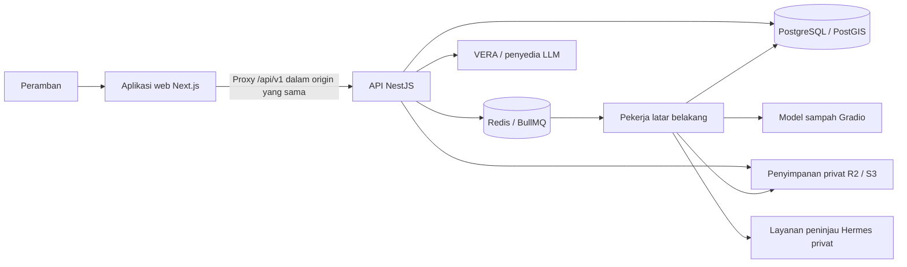

<p align="center">
  <a href="https://vergo.venlab.tech/">
    
  </a>
</p>

<h1 align="center">VERGO · Verifikasi dan Tindak Lanjut</h1>

<p align="center">
  <strong>Bukti foto. Laporan terverifikasi. Aksi komunitas.</strong><br />
  Kecerdasan buatan multimodal dan intelijen geospasial untuk pelaporan sampah dan tindak lanjut.
</p>

<p align="center">
  <a href="https://vergo.venlab.tech/"></a>
  <a href="https://github.com/sitaurs/VERGO"></a>
</p>

<p align="center">
  
  
  
  
  
  
</p>

<p align="center">
  <a href="#gagasan">Gagasan</a> ·
  <a href="#jalur-sdg-3">Jalur SDG 3</a> ·
  <a href="#fitur">Fitur</a> ·
  <a href="#arsitektur">Arsitektur</a> ·
  <a href="#mulai">Mulai</a> ·
  <a href="#dokumentasi">Dokumentasi</a>
</p>

---

## Gagasan

**VERGO mengubah pengamatan sehari-hari menjadi laporan lingkungan terstruktur yang dapat ditinjau dan ditindaklanjuti.** Pemindaian gambar berbantuan AI bersifat opsional dan dapat menyarankan kategori material sampah; laporan juga mencatat lokasi, waktu, dan konteks. Moderator manusia menentukan bukti yang dapat diverifikasi dan dibagikan. Fitur komunitas dan relawan dapat mendokumentasikan tindak lanjut.

Platform ini menyatukan alur tersebut dengan dasbor pribadi, informasi geografis, dan **VERA**, asisten virtual untuk panduan penggunaan VERGO dan informasi lingkungan.

Fokus kompetisi adalah **“VERGO: Optimalisasi Pelaporan Sampah Terverifikasi Berbasis Kecerdasan Buatan Multimodal dan Intelijen Geospasial untuk Mendukung Kehidupan Sehat dan Sejahtera 2030.”** Judul ini menggambarkan kontribusi yang ingin dicapai; jalur kontribusi terhadap SDG 3 yang konkret dan berbasis bukti dijelaskan di bawah.

**Kunjungi situs: [vergo.venlab.tech](https://vergo.venlab.tech/).** Antarmuka menggunakan bahasa Inggris secara bawaan; pengguna dapat memilih bahasa Indonesia melalui menu Pengaturan, dan pilihan bahasa akan disimpan.

**Repositori sumber: [sitaurs/VERGO](https://github.com/sitaurs/VERGO).**

## Jalur SDG 3

Kaitan VERGO yang paling langsung dengan SDG 3 adalah **Target 3.9**, yang menyerukan pengurangan kematian dan penyakit akibat bahan kimia berbahaya serta pencemaran dan kontaminasi udara, air, dan tanah ([Tujuan 3 Perserikatan Bangsa-Bangsa](https://sdgs.un.org/goals/goal3)). Penumpukan sampah dapat menjadi bagian dari persoalan kesehatan lingkungan setempat, tetapi laporan sampah saja tidak membuktikan adanya kontaminasi, paparan, ataupun dampak kesehatan. VERGO berkontribusi pada tahap awal dengan memudahkan pengamatan untuk ditinjau dan ditindaklanjuti:

1. **Dokumentasikan pengamatan.** Warga dapat mengirim foto, lokasi, waktu, dan konteks. Pemindaian bersifat opsional; laporan tidak harus diawali dengan pemindaian AI.
2. **Susun bukti secara terstruktur.** Inferensi EcoLens yang sudah tersedia dan fitur visi multimodal opsional dapat menyarankan kategori material. Saran kategori tidak membuktikan kebenaran laporan, bahwa material tersebut berbahaya, ataupun bahwa seseorang telah terpapar.
3. **Tinjau sebelum dibagikan.** Moderator manusia meninjau laporan, menangani duplikasi dan bukti tindak lanjut, serta mengendalikan laporan yang memenuhi syarat untuk ditampilkan kepada publik. Bukti privat dan data lokasi terperinci tunduk pada kontrol akses, persetujuan, dan publikasi yang ditetapkan produk.
4. **Amati kemunculan laporan berulang.** Laporan yang memenuhi syarat diagregasikan menjadi ringkasan area H3 untuk periode tertentu. Tingkat rendah/sedang/tinggi pada peta menggambarkan konsentrasi laporan berdasarkan aturan jumlah dan tanggal yang terdokumentasi; tingkat tersebut bukan ukuran medis, toksikologis, ataupun pencemaran. Area tanpa laporan berarti “tidak ada data”, bukan “aman”.
5. **Dokumentasikan respons.** Fitur pembaruan komunitas dan kegiatan relawan dapat mencatat tindak lanjut, partisipasi, dan bukti hasil. Informasi ini dapat membantu pihak yang bertanggung jawab atas aksi lokal dalam menentukan prioritas dan meninjau laporan berulang; VERGO tidak mengirim tim pembersihan secara otomatis.

Kontribusi ini **bersifat tidak langsung dan bergantung pada kondisi tertentu**. Manfaat kesehatan bergantung pada ketepatan pengamatan, tindak lanjut yang sesuai dan aman, serta kondisi di lapangan. VERGO bukan sistem surveilans penyakit, layanan toksikologi, ataupun sensor udara, air, atau tanah. VERGO tidak mendiagnosis penyakit, menghitung indikator resmi SDG 3, atau membuktikan penurunan penyakit maupun kematian. Laporan yang diverifikasi moderator berarti buktinya telah ditinjau berdasarkan aturan aplikasi; itu tidak berarti lokasi bebas bahaya atau sudah dibersihkan.

Untuk uji coba lapangan, ukuran yang berguna pada tingkat VERGO meliputi **jumlah laporan unik berdasarkan status dan area**, waktu dari pengiriman hingga keputusan moderator, laporan dengan tindak lanjut atau bukti penyelesaian yang terdokumentasi, laporan berulang di area yang sama dalam periode tertentu, serta kegiatan relawan dengan hasil yang tercatat. Ukuran ini menggambarkan penggunaan platform dan respons yang terdokumentasi; ukuran tersebut bukan pengganti indikator kesehatan resmi SDG 3 atau bukti berkurangnya penyakit. Laporkan ukuran tersebut hanya jika data dasar dan metodenya tersedia.

## Fitur

| Fitur | Fungsi |
| --- | --- |
| **Pengenalan sampah** | Ambil atau unggah foto untuk memperoleh klasifikasi material berbantuan AI. |
| **Laporan berbasis bukti** | Kirim foto, lokasi, dan konteks; pantau laporan selama proses moderasi manusia. |
| **Insiden publik dan peta area** | Jelajahi laporan yang memenuhi syarat dan telah ditinjau moderator, serta ringkasan H3 tentang konsentrasi dan pengulangan laporan. Tingkat area bukan ukuran risiko kesehatan atau pencemaran; keterlihatan publik dikendalikan terpisah dari bukti privat. |
| **Dasbor pribadi** | Lihat riwayat pemindaian dan laporan, poin, pencapaian, notifikasi, serta pengaturan akun. |
| **Asisten VERA** | Minta panduan fitur dan informasi lingkungan; saran serta alat akun yang diizinkan hanya dapat membaca data. |

### Modul komunitas dan operasional

| Modul | Fungsi |
| --- | --- |
| **Pembaruan komunitas** | Catat bukti tindak lanjut dan dukung peninjauan perubahan kondisi. |
| **Kegiatan relawan** | Atur kegiatan pembersihan, kelola peserta, serta catat kehadiran dan hasil. |
| **Ringkasan dampak** | Sajikan hasil kegiatan dan partisipasi yang tercatat. |
| **Peninjauan berbantuan Hermes** | Siapkan rekomendasi bukti terstruktur bagi moderator manusia. |
| **Alur kerja Instagram** | Siapkan dan publikasikan konten yang disetujui melalui kontrol persetujuan dan publikasi. |

Modul-modul ini dikendalikan oleh penanda fitur (feature flag) dan memerlukan migrasi serta layanan pendukungnya. Konfigurasi lingkungan contoh menonaktifkan ekstensi secara bawaan. Lihat [ringkasan proyek](docs/RINGKASAN_PROYEK.md) untuk bukti bertanggal dan [rencana aktif](docs/RENCANA_ITASE_2026.md#gerbang-rilis) untuk pekerjaan penerimaan yang masih tersisa.

### Alur produk

**Amati → Dokumentasikan → Kirim → Tinjauan manusia → Jelajahi → Tindak lanjuti**

Pemindaian dapat menyarankan kategori material, tetapi bersifat opsional dan tidak memverifikasi laporan. Laporan publik melewati proses moderasi. Ringkasan geografis menggambarkan laporan tercatat yang memenuhi syarat dan pola historisnya. VERA memberi panduan tanpa mengubah data akun atau status laporan, sementara rekomendasi Hermes tetap harus ditinjau manusia.

## Arsitektur



| Lapisan | Teknologi |
| --- | --- |
| Antarmuka | Next.js 16 App Router, React 19, TypeScript |
| Gaya dan animasi | Tailwind CSS 4, Motion, ikon Lucide |
| Peta dan indeks spasial | Mapbox GL JS, Leaflet, PostGIS, H3 |
| API HTTP | NestJS 12, REST berversi di `/api/v1` |
| Persistensi dan pencarian | PostgreSQL, migrasi SQL, pgvector, pencarian teks lengkap |
| Pemrosesan latar belakang | Redis dan BullMQ |
| Media | Penyimpanan objek privat yang kompatibel dengan Cloudflare R2 / S3 |
| Inferensi sampah | Layanan Gradio yang di-host sendiri dengan model EcoLens |
| Asisten | LangGraph dan penyedia LLM yang kompatibel dengan OpenAI |
| Kontrak | Skema OpenAPI, tipe TypeScript yang dihasilkan, dan data uji bersama |

### Peta repositori

```text
.
├── apps/
│   ├── web/               Antarmuka Next.js dan proxy API dalam origin yang sama
│   ├── api/               API NestJS, migrasi, dan pengujian sisi server
│   └── worker/            Pemrosesan pemindaian dan pekerjaan latar belakang
├── packages/config/       Validasi lingkungan bersama
├── contracts/             Kontrak OpenAPI terbit dan data uji
│   └── r1/                Draf kontrak ekstensi
├── services/hermes-review/ Layanan peninjauan berbantuan privat
├── deploy/                Docker, pencadangan basis data, dan konfigurasi layanan
├── scripts/               Pemeriksaan kontrak dan rute
├── bench/                 Perangkat bantu pembandingan kinerja
└── docs/                  Panduan produk, desain, integrasi, dan operasional
```

VERGO adalah implementasi baru yang mendapat inspirasi dari EcoLens. Kode sumber lama `ecoLens` dan `ecoLens_ML` tetap menjadi bahan referensi dan tidak boleh disalin ke repositori ini atau ditambahkan sebagai submodule maupun subtree. Model yang sudah ada menyediakan inferensi sampah melalui integrasi Gradio.

### Merek dan kompatibilitas teknis

Nama produk publik adalah **VERGO — Verify and Go** (“Verifikasi dan Bertindak”), sedangkan nama tampilan asistennya adalah **VERA**. Dokumen lama mungkin masih menggunakan nama sebelumnya, SAP dan SAPA.

Pengenal teknis yang sudah ada tetap dipertahankan: paket npm seperti `@sap/web`, variabel lingkungan berawalan `SAP_` atau `SAPA_`, kolom preferensi `sapaEnabled`, jalur aset, dan jalur penerapan seperti `/etc/sap/`. Gunakan nama tersebut persis seperti yang didokumentasikan saat mengonfigurasi aplikasi; perubahan merek tidak mengganti API, kolom basis data, atau layanan.

## Mulai

### 1. Siapkan lingkungan

Gunakan **Node.js versi 22 atau lebih baru** dan npm. Sebelum menjalankan API dan worker, siapkan:

- PostgreSQL dengan **PostGIS**, **pgvector**, dan **pg_trgm** yang tersedia.
- Redis dan bucket privat yang kompatibel dengan S3, seperti Cloudflare R2.
- Layanan inferensi Gradio beserta kredensialnya.
- Email transaksional melalui Resend, atau SMTP untuk pengembangan lokal.

[Dockerfile PostgreSQL](deploy/postgres.Dockerfile) yang disertakan menyediakan PostGIS dan pgvector. [File compose penerapan](deploy/compose.yml) menggunakan konfigurasi yang dikelola operator di `/etc/sap/` dan jaringan ML privat; ikuti [panduan penerapan](docs/DEPLOYMENT.md) saat menyiapkan lingkungan tersebut.

### 2. Konfigurasikan aplikasi

Untuk salinan kerja baru:

```sh
git clone https://github.com/sitaurs/VERGO.git
cd VERGO
```

Untuk salinan kerja baru, jalankan perintah berikut dari direktori utama repositori. Pertahankan berkas lingkungan yang sudah dikonfigurasi jika Anda telah memilikinya.

```sh
cp .env.example .env
cp apps/web/.env.example apps/web/.env.local
npm ci
```

`cp` juga tersedia sebagai alias di PowerShell. Ganti nilai contoh dalam `.env` dengan konfigurasi layanan privat Anda. Validator akan menolak kredensial contoh.

| Konfigurasi | Fungsi |
| --- | --- |
| `APP_ORIGIN` | Alamat asal yang digunakan peramban; gunakan `http://localhost:3000` untuk pengembangan lokal. |
| `API_INTERNAL_URL` | Alamat sisi server; gunakan `http://localhost:3001` secara lokal. Atur juga nilai ini di `apps/web/.env.local`. |
| `DATABASE_URL`, `DATABASE_DIRECT_URL` | Koneksi basis data saat aplikasi berjalan dan koneksi langsung opsional untuk migrasi. |
| `REDIS_URL` | URL koneksi Redis yang digunakan pemrosesan latar belakang. |
| `SESSION_SECRET`, `CSRF_SECRET` | Rahasia acak yang berbeda, masing-masing minimal 32 karakter. |
| `MAIL_TRANSPORT`, pengaturan email | Pengiriman email; secara bawaan menggunakan Resend, SMTP tersedia untuk penggunaan lokal. |
| `S3_*` | Endpoint penyimpanan privat, bucket, dan kredensial akses. |
| `ML_*` | Endpoint Gradio, rute prediksi, kredensial, dan batas waktu. |

Proxy menggunakan `API_INTERNAL_URL` dan menerima alias lama `SAPA_API_BASE_URL`. Simpan kredensial penyedia di server dan jangan letakkan di pengaturan `NEXT_PUBLIC_*`. Berkas lingkungan harus tetap tidak di-commit. Referensi konfigurasi lengkap dimulai di [`.env.example`](.env.example).

### 3. Bangun paket bersama dan terapkan migrasi

```sh
npm run build
npm run migrate -w @sap/api
```

Jika tersedia, migrasi akan memprioritaskan `DATABASE_DIRECT_URL`. Pastikan akun basis data dapat memasang ekstensi yang diperlukan dan menerapkan perubahan skema.

### 4. Jalankan tiga proses

Jalankan setiap perintah di terminal terpisah dari direktori utama repositori:

| Proses | Perintah | Alamat bawaan |
| --- | --- | --- |
| API | `npm run dev:api` | `http://localhost:3001` |
| Worker | `npm run dev:worker` | Proses latar belakang |
| Web | `npm run dev:web` | `http://localhost:3000` |

Buka **[localhost:3000](http://localhost:3000)**. Periksa **[kesiapan API](http://localhost:3000/api/v1/health/ready)**, pastikan `data.ready` bernilai `true`, dan periksa status dependensi. Buat akun dan verifikasi kode yang dikirim melalui email sebelum menggunakan dasbor. Pemindaian lengkap memerlukan Redis dan penyimpanan privat yang sehat, worker yang berjalan, serta integrasi Gradio yang sehat.

<details>
<summary><strong>Aktifkan kemampuan opsional</strong></summary>

Aktifkan VERA dengan `SAPA_FEATURE_ENABLED=true` dan konfigurasikan `SAPA_LLM_BASE_URL`, `SAPA_LLM_API_KEY`, serta `SAPA_LLM_MODEL`. Nama konfigurasi ini tetap memakai awalan `SAPA_` aslinya. Baca [panduan asisten](docs/SAPA_ASSISTANT.md) sebelum mengaktifkan pengambilan informasi hibrida.

Fitur komunitas dan kegiatan menggunakan `SAP_EXTENSION_ENABLED` bersama `SAP_COMMUNITY_ENABLED` dan `SAP_ACTIVITIES_ENABLED`. Hermes menggunakan `SAP_HERMES_ENABLED` dan [konfigurasi layanan privatnya](services/hermes-review/README.md). Pembuatan tampilan dan penerbitan konten Instagram memiliki penanda fitur terpisah serta memerlukan integrasi Meta, persetujuan, dan alur persetujuan publikasi.

Terapkan migrasi yang relevan dan konfigurasikan layanan pendukung sebelum mengaktifkan modul. Mulai ulang proses yang terdampak setelah mengubah lingkungan. Lihat [kesepakatan integrasi](docs/CONTRACT_ZAKA_ZAMANI.md) dan [rencana aktif](docs/RENCANA_ITASE_2026.md) untuk persyaratan lengkap.

</details>

<details>
<summary><strong>Buka aplikasi pengembangan dari perangkat lain</strong></summary>

Atur `APP_ORIGIN` di sisi server ke URL antarmuka web yang tepat, misalnya `http://192.168.1.20:3000`. Di `apps/web/.env.local`, atur `SAP_ALLOWED_DEV_ORIGINS=192.168.1.20` dengan hanya nama host atau alamat IP. Mulai ulang layanan sisi server, lalu jalankan aplikasi web dengan:

```sh
npm run dev:web -- --hostname 0.0.0.0
```

Buka `http://192.168.1.20:3000` dari perangkat lain menggunakan alamat IP host Anda yang sebenarnya.

</details>

## Pengembangan dan validasi

Jalankan perintah berikut dari direktori utama repositori:

| Perintah | Fungsi |
| --- | --- |
| `npm run build` | Bangun paket konfigurasi, API, dan worker. |
| `npm run build -w @sap/web` | Bangun aplikasi web untuk produksi. |
| `npm run typecheck` | Periksa TypeScript di seluruh ruang kerja npm. |
| `npm run contracts:check` | Validasi kontrak dan data uji. |
| `npm run contracts:routes` | Periksa rute API terhadap draf kontrak ekstensi. |
| `npm run contracts:types -w @sap/web` | Buat ulang tipe dari kontrak API yang telah diterbitkan. |
| `npm run contracts:r1:types -w @sap/web` | Buat ulang tipe dari draf ekstensi R1. |
| `npm run test` | Jalankan pengujian ruang kerja npm dan pengujian Python Hermes. |
| `npm run test:r1 -w @sap/web` | Jalankan rangkaian Playwright untuk web. |
| `npm run check` | Jalankan validasi kontrak, pemeriksaan tipe, pengujian, build sisi server, dan pemeriksaan rute. |

Untuk perubahan aplikasi, jalankan `npm run check` sebelum melakukan commit. Untuk pembaruan dokumentasi saja, periksa tautan, aset yang dirujuk, dan contoh perintah. Skrip pengujian Hermes menggunakan sintaks shell POSIX dan `python3`; di Windows, jalankan pemeriksaan lengkap dari WSL atau Git Bash dengan Python tersedia. Playwright memerlukan dependensi browser dan lingkungan sesuai konfigurasinya. Pengujian integrasi basis data memerlukan basis data pengujian khusus; lihat [rencana pengujian](docs/TEST_PLAN.md).

Kontrak API yang telah diterbitkan adalah `1.1.0`; skema ekstensi R1 adalah draf `1.2.0`. Saat mengubah perilaku API, selaraskan pengendali (handler), skema, data uji, dan tipe antarmuka web yang dihasilkan. Pemeriksaan lokal memvalidasi repositori; penerimaan layanan eksternal dan penerapan dicatat di [gerbang rilis aktif](docs/RENCANA_ITASE_2026.md#gerbang-rilis). Hasil historis disertai tanggal di [ringkasan proyek](docs/RINGKASAN_PROYEK.md).

## Dokumentasi

| Panduan | Rujukan |
| --- | --- |
| [Indeks dokumentasi](docs/README.md) | Panduan yang dipelihara dan kontrak sumber. |
| [Ringkasan proyek](docs/RINGKASAN_PROYEK.md) | Fitur yang ada, keputusan, navigasi saat ini, bukti bertanggal, dan rencana historis yang dihimpun. |
| [Rencana ITASE 2026](docs/RENCANA_ITASE_2026.md) | Daftar pekerjaan aktif untuk SDG 3, kepercayaan laporan, UX, tindak lanjut, luaran kompetisi, dan penerimaan. |
| [Persyaratan produk](docs/PRD.md) | Tujuan, pengguna, dan cakupan dasar produk. |
| [Arsitektur](docs/TECH_SPEC.md) | Tumpukan teknologi saat ini dan batasan domain. |
| [Panduan VERA](docs/SAPA_ASSISTANT.md) | Perilaku asisten dan konfigurasi dengan nama berkas teknis asli. |
| [API terbit](contracts/openapi.json) / [draf R1](contracts/r1/README.md) | Skema yang dapat dibaca mesin dan aturan peningkatan versi. |
| [Kontrak ekstensi](docs/CONTRACT_ZAKA_ZAMANI.md) | DTO antarmuka web dan sisi server bersama serta alur kerja. |
| [Moderasi](docs/CONTENT_OPERATIONS.md) | Tinjauan manusia, privasi, dan operasional. |
| [Panduan penerapan](docs/DEPLOYMENT.md) | Konfigurasi lingkungan aplikasi saat berjalan dan pemulihan. |
| [Persiapan deployment Vercel](docs/DEPLOYMENT_VERCEL.md) | Pemisahan proyek web/API, environment, direct upload R2, migrasi, dan worker Armbian. |

---

<p align="center">
  <strong>Tempat yang lebih bersih dimulai dari seseorang yang peduli dan mau bertindak.</strong><br />
  <a href="https://vergo.venlab.tech/">Buka VERGO →</a>
</p>
