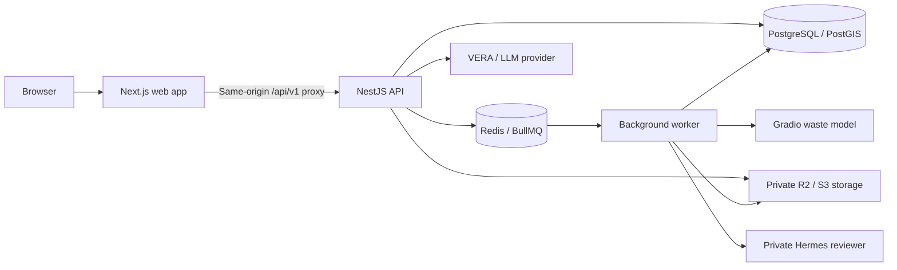

<p align="center">
  <a href="https://vergo.venlab.tech/">
    
  </a>
</p>

<h1 align="center">VERGO · Verify and Go</h1>

<p align="center">
  <strong>Photo evidence. Verified reports. Community action.</strong><br />
  Multimodal AI and geospatial intelligence for waste reporting and follow-up.
</p>

<p align="center">
  <a href="https://vergo.venlab.tech/"></a>
  <a href="https://github.com/sitaurs/VERGO"></a>
</p>

<p align="center">
  
  
  
  
  
  
</p>

<p align="center">
  <a href="#the-idea">The idea</a> ·
  <a href="#sdg-3-pathway">SDG 3 pathway</a> ·
  <a href="#features">Features</a> ·
  <a href="#architecture">Architecture</a> ·
  <a href="#getting-started">Quick start</a> ·
  <a href="#documentation">Documentation</a>
</p>

---

## The idea

**VERGO turns everyday observations into structured environmental reports that people can review and act on.** An optional AI-assisted image scan suggests a waste-material category; a report captures location, time, and context. Human moderators decide what evidence can be verified and shared. Community and volunteer tools can document follow-up.

The platform brings these flows together with a personal dashboard, geographic insights, and **VERA**, the virtual assistant for guidance on VERGO and environmental topics.

The competition focus is **“VERGO: Optimalisasi Pelaporan Sampah Terverifikasi Berbasis Multimodal Artificial Intelligence dan Geospatial Intelligence Menuju Good Health and Well-being 2030.”** This title describes the intended contribution; the concrete, evidence-based pathway to SDG 3 is set out below.

**Visit the website: [vergo.venlab.tech](https://vergo.venlab.tech/).** The interface defaults to English; users can choose Indonesian in Settings, and saved language preferences are preserved.

**Source repository: [sitaurs/VERGO](https://github.com/sitaurs/VERGO).**

## SDG 3 pathway

VERGO's most direct SDG 3 connection is **Target 3.9**, which calls for fewer deaths and illnesses related to hazardous chemicals and air, water, and soil pollution and contamination ([United Nations Goal 3](https://sdgs.un.org/goals/goal3)). Waste accumulation can be part of a local environmental-health concern, but a waste report alone does not establish contamination, exposure, or a health effect. VERGO contributes upstream by making observations easier to review and follow up:

1. **Document an observation.** A resident can submit a photo, location, time, and context. Scanning is optional; a report does not need to begin with an AI scan.
2. **Structure the evidence.** The existing EcoLens inference and optional multimodal vision can suggest a material category. A category suggestion does not establish that a report is true, that material is hazardous, or that anyone has been exposed to it.
3. **Review before sharing.** A human moderator reviews reports, handles duplicates and follow-up evidence, and controls what is eligible for public display. Private evidence and precise location data are subject to the product's access, consent, and publication controls.
4. **See where reports recur.** Eligible reports are aggregated into H3 area summaries for a stated period. The map's low/medium/high level describes report concentration under the documented count-and-date rules; it is not a medical, toxicological, or pollution measurement. An area with no reports means “no data,” not “safe.”
5. **Document a response.** Community updates and volunteer activity workflows can record follow-up, participation, and evidence of results. This can help people responsible for local action prioritize and review recurring reports; VERGO does not dispatch a cleanup team automatically.

This is an **indirect and conditional contribution** to healthier environments. Any health benefit depends on accurate observations, appropriate and safe follow-up, and conditions in the field. VERGO is not disease surveillance, a toxicology service, or an air, water, or soil sensor. It does not diagnose illness, calculate official SDG 3 indicators, or prove a reduction in illness or deaths. A moderator-verified report means its evidence was reviewed under the app's rules; it does not mean a site is hazard-free or has been cleaned.

For a field pilot, useful **VERGO-level measures** include unique reports by status and area, time from submission to moderator decision, reports with documented follow-up or resolution evidence, recurring reports in the same area over a defined period, and volunteer activities with recorded outcomes. These describe platform use and documented response; they are not substitutes for official SDG 3 health indicators or evidence of reduced disease. Report them only when the underlying data and method are available.

## Features

| Feature | What it does |
| --- | --- |
| **Waste recognition** | Capture or upload a photo and receive AI-assisted material classification. |
| **Evidence-based reports** | Submit photos, location, and context; track the report through human moderation. |
| **Public incidents and area maps** | Explore eligible, moderator-reviewed reports and H3 summaries of report concentration and recurrence. Area levels are not health-risk or pollution measurements; public visibility is controlled separately from private evidence. |
| **Personal dashboard** | View scan and report history, points, achievements, notifications, and account settings. |
| **VERA assistant** | Ask for feature guidance and environmental information; suggestions and permitted account tools remain read-only. |

### Community and operations modules

| Module | Purpose |
| --- | --- |
| **Community updates** | Record follow-up evidence and support review of changing conditions. |
| **Volunteer activities** | Organize cleanup activities, manage participants, and record attendance and results. |
| **Impact summaries** | Present recorded activity outcomes and participation. |
| **Hermes-assisted review** | Prepare structured evidence recommendations for human moderators. |
| **Instagram workflows** | Prepare and publish approved content through consent and publication controls. |

These modules are controlled by feature flags and require their associated migrations and services. The example environment disables the extensions by default. Consult the [project summary](docs/RINGKASAN_PROYEK.md) for dated evidence and the [active plan](docs/RENCANA_ITASE_2026.md#gerbang-rilis) for remaining acceptance work.

### The product loop

**Notice → Document → Submit → Human review → Explore → Follow up**

Scanning can suggest a material category, but it is optional and does not verify a report. Public reports pass through moderation. Geographic summaries describe eligible recorded reports and historical patterns. VERA provides guidance without changing account data or report status, and Hermes recommendations remain subject to human review.

## Architecture



| Layer | Technology |
| --- | --- |
| Frontend | Next.js 16 App Router, React 19, TypeScript |
| Styling and motion | Tailwind CSS 4, Motion, Lucide icons |
| Maps and spatial indexing | Mapbox GL JS, Leaflet, PostGIS, H3 |
| HTTP API | NestJS 12, versioned REST at `/api/v1` |
| Persistence and retrieval | PostgreSQL, SQL migrations, pgvector, full-text search |
| Background processing | Redis and BullMQ |
| Media | Cloudflare R2 / S3-compatible private object storage |
| Waste inference | Self-hosted Gradio service using the EcoLens model |
| Assistant | LangGraph and an OpenAI-compatible LLM provider |
| Contracts | OpenAPI schemas, generated TypeScript types, and shared fixtures |

### Repository map

```text
.
├── apps/
│   ├── web/               Next.js frontend and same-origin API proxy
│   ├── api/               NestJS API, migrations, and backend tests
│   └── worker/            Scan processing and background jobs
├── packages/config/       Shared environment validation
├── contracts/             Published OpenAPI contract and fixtures
│   └── r1/                Extension contract draft
├── services/hermes-review/ Private assisted-review service
├── deploy/                Docker, database backups, and service configuration
├── scripts/               Contract and route checks
├── bench/                 Benchmark tooling
└── docs/                  Product, design, integration, and operations guides
```

VERGO is a fresh implementation informed by EcoLens. Legacy `ecoLens` and `ecoLens_ML` source remains reference material and must not be copied into this repository or added as a submodule or subtree. The existing model supplies waste inference through the Gradio integration.

### Branding and technical compatibility

The public product name is **VERGO — Verify and Go**, and the assistant's display name is **VERA**. Earlier documents may still use the former names SAP and SAPA.

Existing technical identifiers remain unchanged: npm packages such as `@sap/web`, environment variables prefixed with `SAP_` or `SAPA_`, the `sapaEnabled` preference field, asset paths, and deployment paths such as `/etc/sap/`. Use these names exactly as documented when configuring the application; the rebrand does not rename APIs, database fields, or services.

## Getting started

### 1. Prepare your environment

Use **Node.js 22 or later** and npm. Before starting the API and worker, prepare:

- PostgreSQL with **PostGIS**, **pgvector**, and **pg_trgm** available.
- Redis and a private S3-compatible bucket, such as Cloudflare R2.
- A configured Gradio inference service and its credentials.
- Transactional email through Resend, or SMTP for local development.

The included [PostgreSQL Dockerfile](deploy/postgres.Dockerfile) packages PostGIS and pgvector. The [deployment compose file](deploy/compose.yml) uses operator-managed configuration under `/etc/sap/` and a private ML network; follow the [deployment guide](docs/DEPLOYMENT.md) when preparing that environment.

### 2. Configure the application

For a new checkout:

```sh
git clone https://github.com/sitaurs/VERGO.git
cd VERGO
```

For a fresh checkout, run from the repository root. Keep existing configured environment files if you already have them.

```sh
cp .env.example .env
cp apps/web/.env.example apps/web/.env.local
npm ci
```

`cp` is also available as an alias in PowerShell. Replace the placeholders in `.env` with your private service configuration. The validator rejects example credentials.

| Configuration | Purpose |
| --- | --- |
| `APP_ORIGIN` | Browser-facing origin; `http://localhost:3000` for local development. |
| `API_INTERNAL_URL` | Backend origin; `http://localhost:3001` locally. Also set this in `apps/web/.env.local`. |
| `DATABASE_URL`, `DATABASE_DIRECT_URL` | Runtime database connection and optional direct migration connection. |
| `REDIS_URL` | Native Redis connection URL used by background processing. |
| `SESSION_SECRET`, `CSRF_SECRET` | Independent random secrets of at least 32 characters each. |
| `MAIL_TRANSPORT`, mail settings | Email delivery; Resend by default, SMTP available locally. |
| `S3_*` | Private storage endpoint, bucket, and access credentials. |
| `ML_*` | Gradio endpoint, prediction route, credentials, and timeout. |

The proxy uses `API_INTERNAL_URL` and accepts the legacy `SAPA_API_BASE_URL` alias. Keep provider credentials on the server and out of `NEXT_PUBLIC_*` settings. Environment files must remain uncommitted. The complete configuration reference starts in [`.env.example`](.env.example).

### 3. Build shared packages and apply migrations

```sh
npm run build
npm run migrate -w @sap/api
```

Migrations prefer `DATABASE_DIRECT_URL` when provided. Ensure the database account can install the required extensions and apply the schema changes.

### 4. Start the three processes

Run each command in a separate terminal from the repository root:

| Process | Command | Default address |
| --- | --- | --- |
| API | `npm run dev:api` | `http://localhost:3001` |
| Worker | `npm run dev:worker` | Background process |
| Web | `npm run dev:web` | `http://localhost:3000` |

Open **[localhost:3000](http://localhost:3000)**. Check **[API readiness](http://localhost:3000/api/v1/health/ready)**, confirm `data.ready` is `true`, and inspect the dependency states. Create an account and verify the emailed code before using the dashboard. Complete scanning requires healthy Redis and private storage, a running worker, and a healthy Gradio integration.

<details>
<summary><strong>Enable optional capabilities</strong></summary>

Enable VERA with `SAPA_FEATURE_ENABLED=true` and configure `SAPA_LLM_BASE_URL`, `SAPA_LLM_API_KEY`, and `SAPA_LLM_MODEL`. These configuration names retain their original `SAPA_` prefix. Read the [assistant guide](docs/SAPA_ASSISTANT.md) before enabling hybrid retrieval.

Community and activities use `SAP_EXTENSION_ENABLED` together with `SAP_COMMUNITY_ENABLED` and `SAP_ACTIVITIES_ENABLED`. Hermes uses `SAP_HERMES_ENABLED` and its [private service configuration](services/hermes-review/README.md). Instagram rendering and publishing have separate flags and require the Meta integration, consent, and approval workflow.

Apply the relevant migrations and configure the supporting services before enabling a module. Restart the affected processes after environment changes. See [the integration agreement](docs/CONTRACT_ZAKA_ZAMANI.md) and [active plan](docs/RENCANA_ITASE_2026.md) for the full requirements.

</details>

<details>
<summary><strong>Open the development app from another device</strong></summary>

Set backend `APP_ORIGIN` to the exact frontend URL, such as `http://192.168.1.20:3000`. In `apps/web/.env.local`, set `SAP_ALLOWED_DEV_ORIGINS=192.168.1.20` using only the hostname or IP address. Restart the backend, then start the web app with:

```sh
npm run dev:web -- --hostname 0.0.0.0
```

Open `http://192.168.1.20:3000` from the other device using your actual host IP.

</details>

## Development and validation

Run these commands from the repository root:

| Command | Purpose |
| --- | --- |
| `npm run build` | Build config, API, and worker packages. |
| `npm run build -w @sap/web` | Build the web app for production. |
| `npm run typecheck` | Check TypeScript across all workspaces. |
| `npm run contracts:check` | Validate contracts and fixtures. |
| `npm run contracts:routes` | Check API routes against the extension contract draft. |
| `npm run contracts:types -w @sap/web` | Regenerate types from the published API contract. |
| `npm run contracts:r1:types -w @sap/web` | Regenerate types from the R1 extension draft. |
| `npm run test` | Run workspace tests and the Hermes Python tests. |
| `npm run test:r1 -w @sap/web` | Run the web Playwright suite. |
| `npm run check` | Run contract validation, typechecks, tests, backend builds, and route checks. |

For application changes, run `npm run check` before committing. For documentation-only updates, check links, referenced assets, and command examples. The Hermes test script uses POSIX shell syntax and `python3`; on Windows, run the full check from WSL or Git Bash with Python available. Playwright requires its browser dependencies and the environment expected by its configuration. Database integration tests require a dedicated test database; see the [test plan](docs/TEST_PLAN.md).

The published API contract is `1.1.0`; the R1 extension schema is a `1.2.0` draft. Keep handlers, schemas, fixtures, and generated frontend types aligned when changing API behavior. Local checks verify the repository; external-service and deployment acceptance is tracked in the [active release gates](docs/RENCANA_ITASE_2026.md#gerbang-rilis). Historical results are dated in the [project summary](docs/RINGKASAN_PROYEK.md).

## Documentation

| Guide | Start here for |
| --- | --- |
| [Documentation index](docs/README.md) | Maintained guides and source contracts. |
| [Project summary](docs/RINGKASAN_PROYEK.md) | Existing features, decisions, current navigation, dated evidence and consolidated historical plans. |
| [ITASE 2026 plan](docs/RENCANA_ITASE_2026.md) | The active backlog for SDG 3, report trust, UX, follow-up, competition deliverables and acceptance. |
| [Product requirements](docs/PRD.md) | Goals, users and baseline product scope. |
| [Architecture](docs/TECH_SPEC.md) | Current stack and domain boundaries. |
| [VERA guide](docs/SAPA_ASSISTANT.md) | Assistant behavior and configuration under the original technical filename. |
| [Published API](contracts/openapi.json) / [R1 draft](contracts/r1/README.md) | Machine-readable schemas and version promotion rules. |
| [Extension contract](docs/CONTRACT_ZAKA_ZAMANI.md) | Shared frontend/backend DTOs and workflows. |
| [Moderation](docs/CONTENT_OPERATIONS.md) | Human review, privacy and operations. |
| [Deployment](docs/DEPLOYMENT.md) | Runtime configuration and recovery. |

---

<p align="center">
  <strong>Every cleaner place starts with someone who notices.</strong><br />
  <a href="https://vergo.venlab.tech/">Explore VERGO →</a>
</p>
