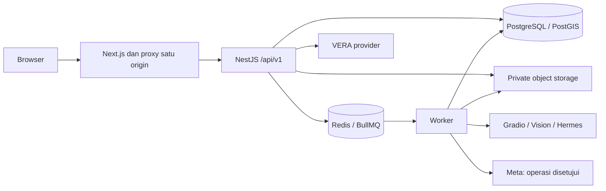

# TECH_SPEC — Arsitektur VERGO

Diperbarui 17 Oktober 2026 berdasarkan source `413100b`. Panduan struktur implementasi; bukan sertifikasi deployment. Kebutuhan baseline tetap di [PRD](PRD.md), [requirements](REQUIREMENTS.md) dan [kontrak extension](CONTRACT_ZAKA_ZAMANI.md).

## 1. Stack dan workspace

| Layer | Implementasi |
| --- | --- |
| Web | Next.js 16 App Router, React 19, TypeScript, Tailwind CSS 4, Motion dan Lucide. |
| Peta | Landing Mapbox GL JS 2D/3D dengan fallback Leaflet; dashboard Leaflet. H3/PostGIS menghitung agregat server. |
| API | NestJS, REST `/api/v1`, DTO/guard/service/repository/serializer. |
| Data | PostgreSQL, PostGIS, pgvector/pg_trgm, client `postgres`, SQL migrations pada `apps/api/migrations`. |
| Jobs | Redis native dan BullMQ; outbox/lease/fencing untuk pekerjaan yang perlu dipulihkan. |
| Media | Private object storage kompatibel S3/R2; original dan rendition dipisahkan. |
| Provider | Gradio self-hosted untuk ML; vision/VERA OpenAI-compatible; Hermes privat; Meta untuk publikasi berizin. |
| Email | Resend default; SMTP hanya development eksplisit sesuai validator konfigurasi. |
| Kontrak | Published OpenAPI 1.1.0 dan draft R1 1.2.0, fixture serta generated types web. |
| Tooling | npm workspaces, Node.js >=22; dependency mengikuti lockfile. |

Workspace: `apps/web`, `apps/api`, `apps/worker`, `packages/config`, `contracts`, `services/hermes-review`, `deploy`, `scripts`, dan `docs`. Generated types berada di `apps/web/lib/api/`; tidak ada asumsi paket `packages/api-client` atau folder `db/migrations` dari brief awal.

## 2. Topologi

Compose produksi mengatur layanan pada host sendiri; Neon/Upstash merupakan pilihan konfigurasi lingkungan terdahulu, bukan syarat arsitektur. Resource/credential per lingkungan dan route Gradio privat mengikuti [DEPLOYMENT.md](DEPLOYMENT.md). Origin di Compose adalah `https://vergo.venlab.tech`; file konfigurasi bukan bukti runtime.

## 3. Aturan lintas modul

- Browser memakai `/api/v1`, sesi opaque cookie dan CSRF; tidak menerima token/provider credential untuk akses langsung ke DB/ML/Hermes/Meta.
- Server memeriksa role, ownership, relasi koordinator/media dan kemampuan menurut state. Guard UI bukan batas keamanan.
- Transaksi domain, revision dan idempotency mencegah replay/konflik menghasilkan perubahan atau award ganda. Queue bukan sumber status domain.
- Foto dinormalisasi/divalidasi dan disimpan privat. Public rendition membutuhkan consent/approval sesuai kanal; GPS presisi dan catatan internal bukan DTO publik.
- AI mengklasifikasikan/memberi saran. Manusia memutuskan verifikasi, koreksi dan resolusi. Laporan manual tetap tersedia saat ML gagal.
- Status laporan, visibility, consent, review, tugas/kegiatan dan publikasi mempunyai lifecycle sendiri.
- Timestamp UTC; kalender bisnis Asia/Jakarta; GeoJSON memakai longitude/latitude. Metode area mengikuti [HOTSPOT_RULES.md](HOTSPOT_RULES.md).
- Retensi/kapasitas merupakan kebijakan operator yang perlu ditetapkan dan dibuktikan, bukan klaim yang disimpulkan dari sebuah env default.

## 4. Sumber detail dan penerimaan

[Database](DATABASE.md), [API](API_SPEC.md), [integrasi](INTEGRATION_CONTRACT.md), [ML](ML_INTEGRATION.md), [VERA](SAPA_ASSISTANT.md), [moderasi](CONTENT_OPERATIONS.md) dan [deployment](DEPLOYMENT.md) memuat aturan per domain.

Bukti lama dan keterbatasannya ada di [ringkasan](RINGKASAN_PROYEK.md#6-bukti-historis-dan-batasnya). Pekerjaan/gerbang aktif ada di [rencana ITASE](RENCANA_ITASE_2026.md#gerbang-rilis); source, health probe dan fixture tidak menggantikan acceptance workflow.
